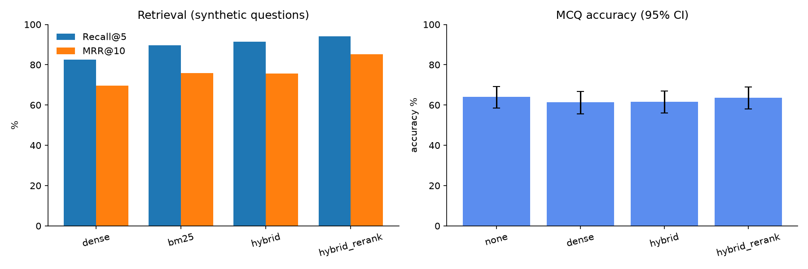

# GuideCite ablation results

Generated by `make report` from the files in `results/`. Do not edit by hand.

## Retrieval (UNVERIFIED (synthetic), n=201)

Recall@k / doc_hit@k in %, MRR@10 in %, latency in ms (single query, laptop).

| mode          |   n |   recall@1 |   recall@3 |   recall@5 |   recall@10 |   mrr@10 |   doc_hit@5 |   latency_ms_p50 |
|:--------------|----:|-----------:|-----------:|-----------:|------------:|---------:|------------:|-----------------:|
| dense         | 201 |       59.2 |       78.1 |       82.6 |        91   |     69.7 |        98   |               32 |
| bm25          | 201 |       66.2 |       84.1 |       89.5 |        93.5 |     75.9 |        97.5 |               20 |
| hybrid        | 201 |       64.7 |       84.1 |       91.5 |        95   |     75.7 |        99   |               61 |
| hybrid_rerank | 201 |       78.1 |       92   |       94   |        95.5 |     85.2 |        99.5 |              867 |

Recall@5 by source (%):

| mode          |   cdc |   nice |   who |
|:--------------|------:|-------:|------:|
| dense         |  83.6 |   86.6 |  77.6 |
| bm25          |  97   |   85.1 |  86.6 |
| hybrid        |  95.5 |   92.5 |  86.6 |
| hybrid_rerank |  97   |   98.5 |  86.6 |

## Generation quality (UNVERIFIED (synthetic), mode=hybrid_rerank, n=50)

- Generator: `ollama:hf.co/Qwen/Qwen3-8B-GGUF:Q4_K_M`; judge: `ollama:hf.co/Qwen/Qwen3-8B-GGUF:Q4_K_M` (small-judge, low reliability)
- Judge and generator are the same model: scores may be biased upward.
- Citation validity (all [n] resolve): 100.0%
- Answers with at least one citation: 98.0%
- In-scope questions where the model declined: 4.0%
- Gold chunk among the 5 passages given to the LLM: 94.0%

| RAGAS metric | mean | NaN (judge failures) |
|---|---|---|
| faithfulness | 0.928 | 0 |
| answer_relevancy | 0.786 | 0 |
| llm_context_precision_with_reference | 0.980 | 0 |
| context_recall | 0.923 | 0 |

Out-of-scope questions (n=20): correctly declined 95%
- medical_not_in_corpus: 100%
- non_medical: 90%

## MCQ: GBaker/MedQA-USMLE-4-options (test, n=300, model `ollama:hf.co/Qwen/Qwen3-8B-GGUF:Q4_K_M`)

Accuracy and 95% Wilson CI in %. McNemar exact test vs `none` on the same items.

| mode          |   n |   accuracy |   ci95_low |   ci95_high |   delta_vs_none |   none_only_correct |   mode_only_correct |   mcnemar_p |   unparsed |
|:--------------|----:|-----------:|-----------:|------------:|----------------:|--------------------:|--------------------:|------------:|-----------:|
| none          | 300 |       64   |       58.4 |        69.2 |           nan   |                 nan |                 nan |    nan      |          1 |
| dense         | 300 |       61.3 |       55.7 |        66.7 |            -2.7 |                  37 |                  29 |      0.3891 |          0 |
| hybrid        | 300 |       61.7 |       56   |        67   |            -2.3 |                  33 |                  26 |      0.435  |          0 |
| hybrid_rerank | 300 |       63.7 |       58.1 |        68.9 |            -0.3 |                  28 |                  27 |      1      |          0 |

Accuracy by exam step (%):

| mode          |   step1 (n=160) |   step2&3 (n=140) |
|:--------------|----------------:|------------------:|
| none          |            61.9 |              66.4 |
| dense         |            60.6 |              62.1 |
| hybrid        |            61.9 |              61.4 |
| hybrid_rerank |            61.3 |              66.4 |

